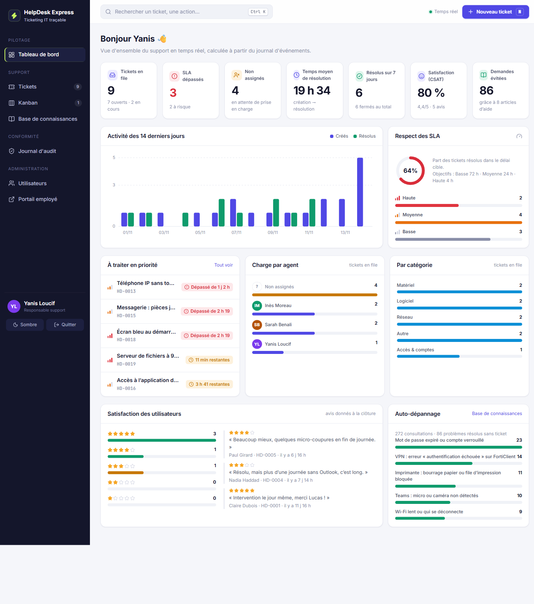
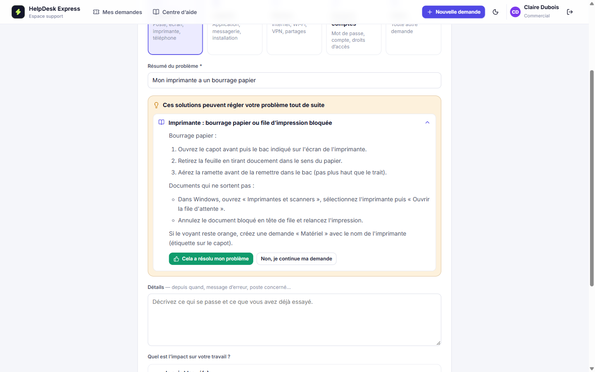
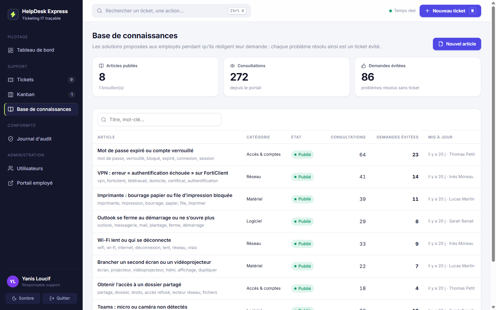

# ⚡ HelpDesk Express

**Le ticketing IT traçable et inaltérable.**
Outil de support informatique bâti sur l'**Event Sourcing** : chaque action est un événement immuable,
scellé par une chaîne d'empreintes SHA-256. Rien n'est jamais écrasé ni effacé.

Deux interfaces, une seule source de vérité :

- **Portail employé** : chaque collaborateur trouve d'abord une solution dans le centre d'aide (proposée
  automatiquement pendant qu'il rédige sa demande), sinon déclare son incident en 30 secondes, suit son
  avancement, puis confirme la résolution en notant l'intervention.
- **Back-office DSI** : réservé à l'équipe informatique. Tableau de bord (SLA, satisfaction, demandes évitées),
  file de tickets, Kanban, réponses types, notes internes, base de connaissances, journal d'audit scellé,
  administration des comptes, import et export des données.

| Portail employé | Back-office DSI |
|---|---|
|  |  |
|  |  |

## Problèmes courants des outils de support, et réponses apportées

Une étude des outils de ticketing du marché (SaaS et open source) fait ressortir des reproches récurrents.
Chacun a guidé une fonctionnalité de HelpDesk Express :

| Problème constaté | Réponse de HelpDesk Express |
|---|---|
| Portails peu utilisés : ils ne servent qu'à « créer un ticket », pas à résoudre plus vite qu'un e-mail | Le portail **propose des solutions pendant la saisie** ; « Cela a résolu mon problème » évite le ticket et est compté (« demandes évitées ») |
| Interfaces datées ou surchargées, formation nécessaire | Parcours employé en 3 champs, langage non technique (« Je suis bloqué(e) »), back-office au clavier (`Ctrl+K`, `N`, `/`) |
| Mise en place longue, nombreux modules et extensions | Un seul processus Node (interface + API), une image Docker, aucun module externe à installer |
| Historique modifiable, pas de piste d'audit fiable (ISO 27001, NIS2) | Event Sourcing **append-only scellé SHA-256**, vérification d'intégrité en un clic |
| Satisfaction mesurée par un outil tiers ou un module en option | **Note et commentaire au moment de la clôture**, CSAT et répartition dans le tableau de bord |
| Données hébergées hors UE, difficulté à récupérer ses données (réversibilité) | **Auto-hébergeable**, polices locales (aucun appel à un service tiers), **export complet** JSON vérifiable, **export RGPD** par personne |
| Import des utilisateurs laborieux | **Import CSV** (export Excel de l'annuaire RH accepté tel quel), identifiants provisoires téléchargeables |
| Réponses répétitives tapées à la main | **Réponses types** personnalisées (prénom, agent) et partage d'un article d'aide en un clic |

## Documents

| Document | Lien |
|---|---|
| Stack technique et architecture (PDF) | [`docs/presentations/HelpDesk-Express-Stack-technique.pdf`](docs/presentations/HelpDesk-Express-Stack-technique.pdf) |
| Plan de tests | [`docs/PLAN_DE_TESTS.md`](docs/PLAN_DE_TESTS.md) |
| Captures d'écran | [`docs/screenshots/`](docs/screenshots) |

## Démarrage rapide

```bash
npm install
npm run seed      # 14 comptes, 21 tickets sur 14 jours, 9 articles d'aide
npm run dev       # API http://localhost:3001  +  interface http://localhost:5173
```

Ouvrez http://localhost:5173 et connectez-vous. Le mot de passe des comptes de démonstration est `demo2026`.

### Production

```bash
npm run build     # vérification des types + interface (dist/) + serveur (dist-server/)
npm start         # un seul processus : interface + API sur http://localhost:3001
```

Ou avec Docker (image Node 22 Alpine, utilisateur non root, données sur un volume, sonde de santé) :

```bash
ADMIN_EMAIL=dsi@entreprise.fr ADMIN_PASSWORD='MotDePasse2026' docker compose up -d   # http://localhost:3000
```

`GET /healthz` renvoie `200 {"status":"ok"}` si le journal est intègre, `503` sinon (supervision, orchestrateur).

| Profil | Compte | Accès |
|---|---|---|
| Employé | `claire.dubois@demo.fr` (+ 8 autres collaborateurs) | Portail : ses propres demandes uniquement |
| Agent DSI | `sarah.benali@demo.fr`, `lucas.martin@demo.fr`, `ines.moreau@demo.fr`, `thomas.petit@demo.fr` | Back-office : tous les tickets, audit |
| Administrateur DSI | `yanis.loucif@demo.fr` | Back-office + gestion des comptes |

| Commande | Rôle |
|---|---|
| `npm run dev` | API tRPC + front Vite en mode développement |
| `npm run seed -- --force` | Réinitialise le journal et l'annuaire avec les données de démo |
| `npm test` | 229 tests unitaires, d'intégration, de sécurité, d'architecture et de composants |
| `npm run test:e2e` | 36 scénarios de bout en bout Playwright (Chromium) |
| `npm run test:all` | Types + tous les tests |
| `npm run test:coverage` | Rapport de couverture |
| `npm run build` / `npm start` | Build puis lancement en production |

## Rôles et droits

| Action | Employé | Agent DSI | Admin DSI |
|---|:-:|:-:|:-:|
| Déclarer une demande, suivre **ses** demandes | ✅ | ✅ | ✅ |
| Répondre sur sa demande, confirmer la résolution (avec une note), rouvrir avec un motif | ✅ | | |
| Consulter le centre d'aide (articles publiés) | ✅ | ✅ | ✅ |
| Rédiger, modifier, publier des articles ; voir les brouillons | ❌ | ✅ | ✅ |
| Voir les notes internes et les étiquettes DSI | ❌ | ✅ | ✅ |
| Voir les demandes des autres collaborateurs | ❌ | ✅ | ✅ |
| Traiter les tickets (statut, priorité, assignation, Kanban) | ❌ | ✅ | ✅ |
| Tableau de bord, journal d'audit, vérification d'intégrité | ❌ | ✅ | ✅ |
| Créer des comptes, changer un rôle, désactiver, réinitialiser un mot de passe | ❌ | ❌ | ✅ |
| Importer des comptes (CSV), exporter toutes les données, export RGPD d'une personne | ❌ | ❌ | ✅ |

Ces droits sont **appliqués côté serveur** (middlewares tRPC `authed` / `staff` / `admin` et politique d'accès
du domaine) ; l'interface ne fait que les refléter. Un employé qui tente d'ouvrir la demande d'un collègue
obtient « introuvable », sans divulguer son existence.

## Fonctionnalités

| | |
|---|---|
| **Portail employé** | Catégories guidées, niveau d'impact traduit en priorité et en délai annoncé, suivi en 5 étapes, conversation avec la DSI, confirmation « Oui, c'est résolu » (note 1 à 5 + commentaire) / « Non, le problème persiste » |
| **Auto-dépannage** | Solutions proposées **pendant la saisie** de la demande (recherche insensible aux accents, aux pluriels, aux tirets), centre d'aide avec recherche et catégories, « Cela a résolu mon problème » = demande évitée |
| **Base de connaissances** | Rédaction par la DSI (étapes numérotées, puces, aperçu), brouillon / publié, mots-clés, statistiques de consultation et d'efficacité par article |
| **Tableau de bord** | Tickets en file, SLA dépassés, non assignés, temps moyen de résolution, **satisfaction (CSAT)**, **demandes évitées**, tendance 14 jours, respect des SLA, charge par agent, priorités, derniers avis, articles les plus utiles |
| **Tickets** | Vues enregistrées (En file, Mes tickets, Non assignés, SLA en danger…), recherche sans accents, filtres, tris, références lisibles `HD-0001` |
| **Kanban** | Glisser-déposer entre statuts, confirmation avant fermeture, cartes verrouillées une fois fermées |
| **Fiche ticket** | Édition en place, assignation, catégorie, priorité, étiquettes, conversation (réponses publiques + notes internes invisibles du demandeur), **réponses types** et partage d'articles, SLA, avis du demandeur |
| **Voyage dans le temps** | Curseur pour revoir l'état exact du ticket à n'importe quelle version (rejeu des événements côté navigateur) |
| **Journal d'audit** | Flux brut de l'Event Store, diff avant → après, acteur authentifié, empreinte SHA-256, **vérification d'intégrité**, export CSV / JSON |
| **Administration** | Annuaire des comptes, rôles, activation / désactivation, mot de passe provisoire, **import CSV**, **export complet** (journal scellé + comptes sans empreintes de mot de passe + articles), **export RGPD** par personne |
| **SLA** | Haute 4 h · Moyenne 24 h · Basse 72 h ; statuts dans les temps / à risque / dépassé / respecté / manqué |
| **UX** | Palette de commandes `Ctrl+K`, raccourcis `N` et `/`, thème clair/sombre, mobile, mises à jour en temps réel, notifications |

## Règles métier

- Création : titre obligatoire (≤ 120 car.), priorité `LOW | MEDIUM | HIGH`, catégorie, demandeur, étiquettes normalisées.
- Un ticket **`CLOSED` ou supprimé ne peut plus être modifié**, assigné ni commenté (ni par la DSI, ni par l'employé).
- Une modification sans effet est refusée (pas d'événement « vide »).
- Suppression **logique** (`TicketDeleted`) : le ticket quitte les vues actives et le portail, son historique reste.
- Un ticket `RESOLVED` peut être rouvert ; par l'employé, uniquement avec un motif, publié dans la conversation.
- Seul le demandeur d'un ticket `RESOLVED` peut le clôturer depuis le portail.
- Deux modifications simultanées du même ticket : la seconde est rejetée (verrou optimiste).
- Un administrateur ne peut ni se rétrograder ni désactiver son propre compte.
- Seul un ticket `RESOLVED` peut être évalué (note entière de 1 à 5, commentaire ≤ 1 000 car.) ; l'avis est un événement `TicketRated` du journal.
- Un article en brouillon n'est ni proposé, ni lisible depuis le portail.

## Sécurité

| Mesure | Détail |
|---|---|
| Mots de passe | `scrypt` salé (N = 16384), comparaison à temps constant, ≥ 8 caractères dont une lettre et un chiffre |
| Session | Jeton signé HMAC-SHA256 dans un cookie `HttpOnly`, `SameSite=Lax`, `Secure` en HTTPS, durée 10 h |
| Révocation | Le compte est relu à chaque requête : désactiver un compte coupe immédiatement ses sessions |
| Force brute | 5 échecs / 5 min par adresse IP + e-mail, message d'erreur identique que le compte existe ou non |
| Cloisonnement | Contrôles côté serveur par rôle et par propriétaire du ticket, notes internes jamais envoyées au portail |
| Traçabilité | L'acteur de chaque événement est l'utilisateur authentifié (plus de sélection manuelle) |
| En-têtes HTTP | `Content-Security-Policy` stricte (aucun script en ligne ni tiers), `X-Frame-Options: DENY`, `nosniff`, `Referrer-Policy`, `Permissions-Policy` |
| Fichiers statiques | Résolution de chemin vérifiée (aucune sortie du dossier `dist`), vraie 404 pour les ressources absentes |
| Exports | Les empreintes de mot de passe ne sortent jamais du serveur ; exports réservés aux administrateurs |
| Confidentialité | Polices auto-hébergées : aucune requête vers un service tiers |

### Variables d'environnement

| Variable | Défaut | Rôle |
|---|---|---|
| `API_PORT` / `PORT` | `3001` | Port du serveur (interface + API) |
| `DATA_DIR` | `data` | Dossier des données |
| `EVENT_STORE_FILE` | `$DATA_DIR/events.jsonl` | Journal d'événements |
| `USERS_FILE` | `$DATA_DIR/users.json` | Annuaire des comptes |
| `ARTICLES_FILE` | `$DATA_DIR/articles.json` | Base de connaissances |
| `STATIC_DIR` | `dist` | Interface compilée servie en production |
| `SESSION_SECRET` | généré dans `$DATA_DIR/session.secret` | Clé de signature des sessions (≥ 32 caractères) |
| `COOKIE_SECURE` | `false` | `true` derrière HTTPS |
| `TRUST_PROXY` | `false` | `true` pour lire l'IP cliente dans `X-Forwarded-For` (reverse proxy) |
| `ADMIN_EMAIL`, `ADMIN_PASSWORD`, `ADMIN_NAME` | — | Crée le premier administrateur au démarrage si l'annuaire est vide |
| `VITE_SHOW_DEMO` | — | `true` pour afficher les comptes de démonstration sur la page de connexion en production |

## Architecture

```
src/
├── domain/          Cœur métier pur — 0 dépendance (vérifié par test)
│   ├── result.ts                Result<E, A> : erreurs métier = valeurs
│   ├── ticket/                  types, decide, evolve, SLA, projections, tableau de bord (dont CSAT)
│   ├── knowledge/article.ts     article, validation, normalisation, pertinence, suggestions
│   ├── identity/types.ts        rôles, utilisateur, validations (compte, mot de passe)
│   └── access/policy.ts         qui voit quoi, actions autorisées au demandeur
├── application/     Use cases + ports — dépend uniquement du domaine
│   ├── ports.ts                 EventStore, UserRepository, ArticleRepository, PasswordHasher, Clock, IdGenerator
│   ├── commands.ts / queries.ts tickets (back-office), évaluation
│   ├── portal.ts                use cases du portail employé (vue filtrée, confirmer + noter, rouvrir)
│   ├── knowledge.ts             recherche, suggestions, lecture, demandes évitées, rédaction
│   ├── portability.ts           export complet et export RGPD
│   ├── identity.ts              authentification, annuaire, mots de passe, import en masse
│   └── auditLog.ts              projection d'audit avec diff
├── infrastructure/  Détails techniques interchangeables
│   ├── eventStore/              mémoire, fichier JSONL append-only, chaîne SHA-256
│   ├── users/ · knowledge/      annuaire et articles : mémoire / fichier JSON (écriture atomique)
│   ├── security/                scrypt, jetons de session, cookies, limitation des tentatives
│   ├── http/staticFiles.ts      service de l'interface compilée + en-têtes de sécurité
│   ├── trpc/router.ts           validation zod, middlewares de rôle, mapping erreurs → HTTP
│   ├── scripts/seed.ts          données de démo (via les vrais use cases)
│   └── server.ts                composition root, /healthz, /trpc, fichiers statiques
└── ui/              React — n'importe de l'infrastructure que des TYPES
    ├── lib/                     client tRPC, session, hooks, filtres, formatage, réponses types, import CSV
    ├── components/              Layout DSI, PortalLayout, palette Ctrl+K, badges, étoiles, suggestions, graphiques SVG
    └── pages/                   Connexion, portail/* (dont centre d'aide), Dashboard, Tickets, Kanban, Fiche,
                                 Base de connaissances, Audit, admin/*
```

**Flux d'une commande** : `React → cookie de session → tRPC (zod + rôle) → use case → readStream → rehydrate →
decide (pur) → append (verrou optimiste + hash) → invalidation des projections`.

**Intégrité** : `hash = SHA256(hashPrécédent + JSON canonique de l'événement)`. Modifier, supprimer ou réordonner
une ligne de `data/events.jsonl` rompt la chaîne ; le journal d'audit l'affiche (« Altération détectée ! »).

## Qualité

- **265 tests automatisés** : 229 unitaires / intégration / sécurité / architecture / composants + 36 parcours Playwright.
- Plan de tests détaillé (identifiants, scénarios Given/When/Then, traçabilité exigences) : [`docs/PLAN_DE_TESTS.md`](docs/PLAN_DE_TESTS.md).

## Stack

TypeScript strict · Node.js (crypto natif) · tRPC v11 · zod · React 18 · React Router · TanStack Query · Vite ·
esbuild · Lucide · Fontsource · Vitest · Testing Library · Playwright · Docker.

## Évolutions envisagées

Event Store PostgreSQL · SSO (OIDC, Microsoft Entra ID) · notifications WebSocket et e-mail ·
snapshots pour gros volumes · e-mail entrant → ticket · intégrations Teams / Slack · inventaire du parc.
