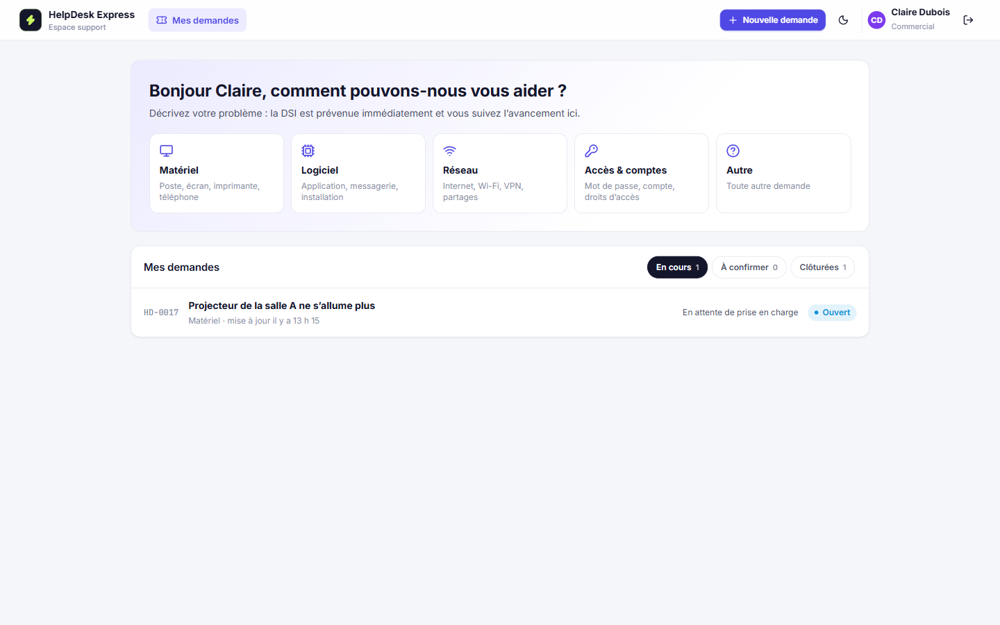

# ⚡ HelpDesk Express

**Le ticketing IT traçable et inaltérable.**
Outil de support informatique bâti sur l'**Event Sourcing** : chaque action est un événement immuable,
scellé par une chaîne d'empreintes SHA-256. Rien n'est jamais écrasé ni effacé.

Deux interfaces, une seule source de vérité :

- **Portail employé** : chaque collaborateur déclare ses incidents en 30 secondes, suit leur avancement
  et confirme (ou conteste) la résolution.
- **Back-office DSI** : réservé à l'équipe informatique. Tableau de bord, file de tickets, Kanban, SLA,
  notes internes, journal d'audit et administration des comptes.

| Portail employé | Back-office DSI |
|---|---|
|  |  |

## Documents

| Document | Lien |
|---|---|
| Stack technique et architecture (PDF) | [`docs/presentations/HelpDesk-Express-Stack-technique.pdf`](docs/presentations/HelpDesk-Express-Stack-technique.pdf) |
| Plan de tests | [`docs/PLAN_DE_TESTS.md`](docs/PLAN_DE_TESTS.md) |
| Captures d'écran | [`docs/screenshots/`](docs/screenshots) |

## Démarrage rapide

```bash
npm install
npm run seed      # 14 comptes + 21 tickets de démonstration sur 14 jours
npm run dev       # API http://localhost:3001  +  interface http://localhost:5173
```

Ouvrez http://localhost:5173 et connectez-vous. Le mot de passe des comptes de démonstration est `demo2026`.

| Profil | Compte | Accès |
|---|---|---|
| Employé | `claire.dubois@demo.fr` (+ 8 autres collaborateurs) | Portail : ses propres demandes uniquement |
| Agent DSI | `sarah.benali@demo.fr`, `lucas.martin@demo.fr`, `ines.moreau@demo.fr`, `thomas.petit@demo.fr` | Back-office : tous les tickets, audit |
| Administrateur DSI | `yanis.loucif@demo.fr` | Back-office + gestion des comptes |

| Commande | Rôle |
|---|---|
| `npm run dev` | API tRPC + front Vite en mode développement |
| `npm run seed -- --force` | Réinitialise le journal et l'annuaire avec les données de démo |
| `npm test` | 187 tests unitaires, d'intégration, de sécurité, d'architecture et de composants |
| `npm run test:e2e` | 30 scénarios de bout en bout Playwright (Chromium) |
| `npm run test:all` | Types + tous les tests |
| `npm run test:coverage` | Rapport de couverture |
| `npm run build` | Build de production |

## Rôles et droits

| Action | Employé | Agent DSI | Admin DSI |
|---|:-:|:-:|:-:|
| Déclarer une demande, suivre **ses** demandes | ✅ | ✅ | ✅ |
| Répondre sur sa demande, confirmer la résolution, rouvrir avec un motif | ✅ | | |
| Voir les notes internes et les étiquettes DSI | ❌ | ✅ | ✅ |
| Voir les demandes des autres collaborateurs | ❌ | ✅ | ✅ |
| Traiter les tickets (statut, priorité, assignation, Kanban) | ❌ | ✅ | ✅ |
| Tableau de bord, journal d'audit, vérification d'intégrité | ❌ | ✅ | ✅ |
| Créer des comptes, changer un rôle, désactiver, réinitialiser un mot de passe | ❌ | ❌ | ✅ |

Ces droits sont **appliqués côté serveur** (middlewares tRPC `authed` / `staff` / `admin` et politique d'accès
du domaine) ; l'interface ne fait que les refléter. Un employé qui tente d'ouvrir la demande d'un collègue
obtient « introuvable », sans divulguer son existence.

## Fonctionnalités

| | |
|---|---|
| **Portail employé** | Catégories guidées, niveau d'impact traduit en priorité et en délai annoncé, suivi en 5 étapes, conversation avec la DSI, confirmation « Oui, c'est résolu » / « Non, le problème persiste » |
| **Tableau de bord** | Tickets en file, SLA dépassés, non assignés, temps moyen de résolution, tendance 14 jours, taux de respect des SLA, charge par agent, tickets à traiter en priorité |
| **Tickets** | Vues enregistrées (En file, Mes tickets, Non assignés, SLA en danger…), recherche sans accents, filtres, tris, références lisibles `HD-0001` |
| **Kanban** | Glisser-déposer entre statuts, confirmation avant fermeture, cartes verrouillées une fois fermées |
| **Fiche ticket** | Édition en place, assignation, catégorie, priorité, étiquettes, conversation (réponses publiques + notes internes invisibles du demandeur), SLA |
| **Voyage dans le temps** | Curseur pour revoir l'état exact du ticket à n'importe quelle version (rejeu des événements côté navigateur) |
| **Journal d'audit** | Flux brut de l'Event Store, diff avant → après, acteur authentifié, empreinte SHA-256, **vérification d'intégrité**, export CSV / JSON |
| **Administration** | Annuaire des comptes, rôles, activation / désactivation, mot de passe provisoire |
| **SLA** | Haute 4 h · Moyenne 24 h · Basse 72 h ; statuts dans les temps / à risque / dépassé / respecté / manqué |
| **UX** | Palette de commandes `Ctrl+K`, raccourcis `N` et `/`, thème clair/sombre, mobile, mises à jour en temps réel, notifications |

## Règles métier

- Création : titre obligatoire (≤ 120 car.), priorité `LOW | MEDIUM | HIGH`, catégorie, demandeur, étiquettes normalisées.
- Un ticket **`CLOSED` ou supprimé ne peut plus être modifié**, assigné ni commenté (ni par la DSI, ni par l'employé).
- Une modification sans effet est refusée (pas d'événement « vide »).
- Suppression **logique** (`TicketDeleted`) : le ticket quitte les vues actives et le portail, son historique reste.
- Un ticket `RESOLVED` peut être rouvert ; par l'employé, uniquement avec un motif, publié dans la conversation.
- Seul le demandeur d'un ticket `RESOLVED` peut le clôturer depuis le portail.
- Deux modifications simultanées du même ticket : la seconde est rejetée (verrou optimiste).
- Un administrateur ne peut ni se rétrograder ni désactiver son propre compte.

## Sécurité

| Mesure | Détail |
|---|---|
| Mots de passe | `scrypt` salé (N = 16384), comparaison à temps constant, ≥ 8 caractères dont une lettre et un chiffre |
| Session | Jeton signé HMAC-SHA256 dans un cookie `HttpOnly`, `SameSite=Lax`, `Secure` en HTTPS, durée 10 h |
| Révocation | Le compte est relu à chaque requête : désactiver un compte coupe immédiatement ses sessions |
| Force brute | 5 échecs / 5 min par adresse IP + e-mail, message d'erreur identique que le compte existe ou non |
| Cloisonnement | Contrôles côté serveur par rôle et par propriétaire du ticket, notes internes jamais envoyées au portail |
| Traçabilité | L'acteur de chaque événement est l'utilisateur authentifié (plus de sélection manuelle) |

### Variables d'environnement

| Variable | Défaut | Rôle |
|---|---|---|
| `API_PORT` | `3001` | Port de l'API |
| `DATA_DIR` | `data` | Dossier des données |
| `EVENT_STORE_FILE` | `$DATA_DIR/events.jsonl` | Journal d'événements |
| `USERS_FILE` | `$DATA_DIR/users.json` | Annuaire des comptes |
| `SESSION_SECRET` | généré dans `$DATA_DIR/session.secret` | Clé de signature des sessions (≥ 32 caractères) |
| `COOKIE_SECURE` | `false` | `true` derrière HTTPS |
| `TRUST_PROXY` | `false` | `true` pour lire l'IP cliente dans `X-Forwarded-For` (reverse proxy) |
| `ADMIN_EMAIL`, `ADMIN_PASSWORD`, `ADMIN_NAME` | — | Crée le premier administrateur au démarrage si l'annuaire est vide |
| `VITE_SHOW_DEMO` | — | `true` pour afficher les comptes de démonstration sur la page de connexion en production |

## Architecture

```
src/
├── domain/          Cœur métier pur — 0 dépendance (vérifié par test)
│   ├── result.ts                Result<E, A> : erreurs métier = valeurs
│   ├── ticket/                  types, decide, evolve, SLA, projections, tableau de bord
│   ├── identity/types.ts        rôles, utilisateur, validations (compte, mot de passe)
│   └── access/policy.ts         qui voit quoi, actions autorisées au demandeur
├── application/     Use cases + ports — dépend uniquement du domaine
│   ├── ports.ts                 EventStoreRepository, UserRepository, PasswordHasher, Clock, IdGenerator
│   ├── commands.ts / queries.ts tickets (back-office)
│   ├── portal.ts                use cases du portail employé (vue filtrée, confirmer, rouvrir)
│   ├── identity.ts              authentification, annuaire, mots de passe
│   └── auditLog.ts              projection d'audit avec diff
├── infrastructure/  Détails techniques interchangeables
│   ├── eventStore/              mémoire, fichier JSONL append-only, chaîne SHA-256
│   ├── users/                   annuaire mémoire / fichier JSON (écriture atomique)
│   ├── security/                scrypt, jetons de session, cookies, limitation des tentatives
│   ├── trpc/router.ts           validation zod, middlewares de rôle, mapping erreurs → HTTP
│   ├── scripts/seed.ts          données de démo (via les vrais use cases)
│   └── server.ts                composition root
└── ui/              React — n'importe de l'infrastructure que des TYPES
    ├── lib/                     client tRPC, session, hooks TanStack Query, filtres, formatage
    ├── components/              Layout DSI, PortalLayout, palette Ctrl+K, badges, graphiques SVG
    └── pages/                   Connexion, portail/*, Dashboard, Tickets, Kanban, Fiche, Audit, admin/*
```

**Flux d'une commande** : `React → cookie de session → tRPC (zod + rôle) → use case → readStream → rehydrate →
decide (pur) → append (verrou optimiste + hash) → invalidation des projections`.

**Intégrité** : `hash = SHA256(hashPrécédent + JSON canonique de l'événement)`. Modifier, supprimer ou réordonner
une ligne de `data/events.jsonl` rompt la chaîne ; le journal d'audit l'affiche (« Altération détectée ! »).

## Qualité

- **217 tests automatisés** : 187 unitaires / intégration / sécurité / composants + 30 parcours Playwright.
- Plan de tests détaillé (identifiants, scénarios Given/When/Then, traçabilité exigences) : [`docs/PLAN_DE_TESTS.md`](docs/PLAN_DE_TESTS.md).

## Stack

TypeScript strict · Node.js (crypto natif) · tRPC v11 · zod · React 18 · React Router · TanStack Query · Vite ·
Lucide · Vitest · Testing Library · Playwright.

## Évolutions envisagées

Event Store PostgreSQL · SSO (OIDC, Microsoft Entra ID) · notifications WebSocket et e-mail ·
snapshots pour gros volumes · e-mail entrant → ticket · intégrations Teams / Slack.
